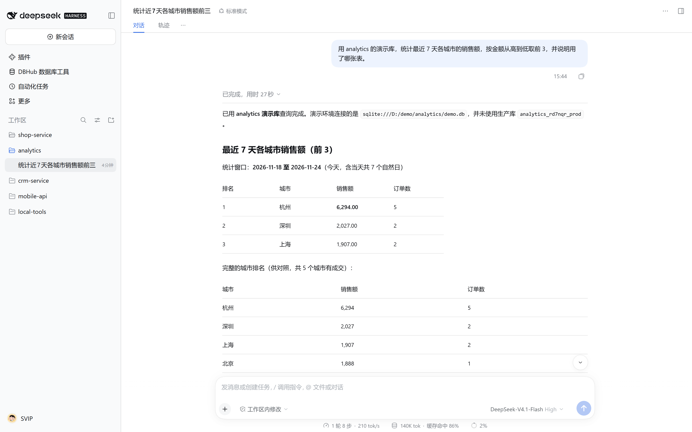

# dsh-dbhub-live

**简体中文** · [English](README.en.md)

[](https://www.npmjs.com/package/dsh-dbhub-live)
[](https://www.npmjs.com/package/dsh-dbhub-live)
[](https://opensource.org/licenses/MIT)
[](https://github.com/bytebase/dbhub)

[DeepSeek Harness](https://github.com/deepseek-ai/DeepSeek-Harness) 的数据库插件：装上它，对话里的 AI 就能直接查你的库。**密码只在界面里输入，不作为工具参数交给模型**——模型只知道「哪个工作区的哪个环境」，以及类型 / 主机 / 端口 / 库名这类元数据。底层是 [DBHub](https://dbhub.ai)，支持 **MySQL · PostgreSQL · MariaDB · SQLite · SQL Server**。

<details>
<summary>📷 界面预览</summary>



</details>

## 功能

| 功能 | 一句话 | 详情 |
| --- | --- | --- |
| 多连接 / 多工作区 | 一个工作区可挂多个环境（`default` / `prod` / `dev`…，名字支持中文），各自独立、不串库。 | [连接管理](https://github.com/mr-mihu/dsh-dbhub-live/blob/dev/doc/REQUIREMENTS.md#三连接管理) |
| 只读模式与 SSH 隧道 | 按环境开启：只读由 dbhub 原生拒绝写操作，隧道让跳板机后面的库也能连。 | [环境选项](https://github.com/mr-mihu/dsh-dbhub-live/blob/dev/doc/REQUIREMENTS.md#十二环境选项与上游能力门槛) |
| `@` 选数据源 | 打 `@` 列出当前工作区的连接；别的库按 Tab 进「其他工作区的连接」。一条消息可引用多个，各自落在自己的库上。 | [多选引用](https://github.com/mr-mihu/dsh-dbhub-live/blob/dev/doc/REQUIREMENTS.md#十五输入框-数据源引用一条消息可多选) |
| 结果行数上限 | 全局设一个默认上限（单次调用可用 `maxRows` 覆盖），免得一次 `select *` 把整张表灌进上下文。 | [上限与落点](https://github.com/mr-mihu/dsh-dbhub-live/blob/dev/doc/CLIENT.md#环境选项的落点只读-ssh-结果行数上限) |
| 排序与复制 | 行可拖拽排序、拖到别的工作区、一键复制；只有行首手柄能拖，行内文字照常选中复制。 | [排序与复制](https://github.com/mr-mihu/dsh-dbhub-live/blob/dev/doc/REQUIREMENTS.md#二十一数据源拖拽排序跨工作区移动与复制) |
| 结果导出 | 结果行多时写成 CSV / JSON 文件，对话里只回摘要和路径。 | [导出规则](https://github.com/mr-mihu/dsh-dbhub-live/blob/dev/doc/REQUIREMENTS.md#二十查询结果导出csv-json) |
| 连接列表与测试 | 连接多了能搜能排；单条或一键测试，测的是该环境真正生效的连接。 | [搜索 / 排序 / 批量测试](https://github.com/mr-mihu/dsh-dbhub-live/blob/dev/doc/REQUIREMENTS.md#十七连接列表的搜索-排序-批量测试) |
| 口令存 DSH 凭据库 | 数据库密码与 SSH 口令只存 DSH 凭据库，连接文件里只有引用名。 | [口令同源](https://github.com/mr-mihu/dsh-dbhub-live/blob/dev/doc/REQUIREMENTS.md#十九数据库口令与-ssh-口令同源dsh-凭据库) |
| 手机端原生面板（dsh-Go） | 在 DSH 的 Android 客户端里，连接列表与常用设置走 App 原生界面：看状态、点连接测一次连通性、切每个连接的只读、改五项设置、启用/停用、刷新。只带元数据，不含 DSN / 账号 / 口令。 | [手机端](https://github.com/mr-mihu/dsh-dbhub-live/blob/dev/doc/REQUIREMENTS.md#二十二dsh-go-手机端原生设置面板) |

配置页适配 **弹窗 / 宽屏 / 小屏** 三种承载。

<details>
<summary>手机端（dsh-Go）能做什么、不能做什么</summary>

| 在手机上 | 说明 |
| --- | --- |
| 看状态与连接 | 插件是否启用、连接数与只读标记（以及是否经 SSH 隧道）、插件版本 |
| 切每个连接的只读 | 点一下把某个环境设为只读 / 可写，和网页版是同一份值。只读开启后由 dbhub 直接拒绝写语句，模型不能替你关掉 |
| 改常用设置 | 结果行数上限（不限 / 100 / 500 / 1000 / 5000 行）、并发测试数（1/2/4/8）、自动更新间隔（不检查 / 1/3/7/14/30 天）、侧边栏入口（显示/隐藏）、注入访问策略（开/关）——点一下即生效 |
| 点一条连接 | 用一次性进程执行 `SELECT 1`，不改任何配置；失败详情写进引擎日志，手机上只给结论 |
| 启用 / 停用、刷新 | 停用会让模型暂时不能调用 `dbhub_*` 工具；刷新重新扫描工作区 |
| ❌ 添加 / 修改连接 | 要填连接串和密码——手机端界面没有密码控件，**一律在网页版设置里做** |
| ❌ 改口令、配 SSH 隧道 | 同上；App 里会有「在网页版设置」入口 |
| ❌ 改导出目录 | 路径是自由文本，且保存时会实测目录可写；手机端只显示当前值，改它请到网页版 |

面板只在装了 dsh-Go 桥接的主机上出现；桌面与网页版不受影响。原生面板需要本插件 **6.1.0** 起。

</details>

<details>
<summary>只读模式与 SSH 隧道（两张表）</summary>

**只读模式 × 会话权限**——两者独立，同时生效：

| 环境只读 | 会话权限 | 写语句 | 读语句 |
| --- | --- | --- | --- |
| 开 | 任意 | dbhub 直接拒绝（`READONLY_VIOLATION`） | 正常执行 |
| 关 | 完全权限 | 直接执行，**不弹窗** | 正常执行 |
| 关 | 工作区内修改 | 每次写入弹窗确认 | 正常执行 |
| 关 | 仅可查看 | 直接拒绝（不启动 dbhub） | 正常执行 |

只读模式**只能由你关闭**，模型不能关。

**子智能体按主输入框那档走**：委派时子任务会继承你选的那一档，不再单独判断。

| 你在主输入框选的 | 子智能体写库 | 说明 |
| --- | --- | --- |
| 完全权限 | 直接执行，不弹窗 | 与主会话一致，无需额外确认 |
| 工作区内修改 | 弹窗（显示在**主会话**里，并标明是子任务发起） | 子会话自身弹不出窗，请求转给发起它的主会话 |
| 仅可查看 | 直接拒绝 | 与主会话一致 |

委派的子任务已经没有可用的主会话时（例如那一轮已结束），写入会**立即**返回「子任务没有可用的授权通道」，不会挂到超时。

**SSH 隧道字段**——口令由 DSH 凭据库保管，只在界面输入、不回显：

| 字段 | 说明 |
| --- | --- |
| SSH 主机 | 域名或 IP；不要填 `~/.ssh/config` 里的别名 |
| 端口 | 默认 `22` |
| SSH 用户 | 登录跳板机用的账号 |
| 认证方式 | 密钥（路径留空用 `~/.ssh/id_ed25519`）或密码 |
| ProxyJump | 可选，只支持一跳，`[user@]host[:port]` |

连接串里的地址要写**从跳板机看过去**的地址——这是隧道连不上最常见的原因。

</details>

<details>
<summary>模型侧访问策略（点开）</summary>

- 本插件里配置过的库只走 `dbhub_*` 工具，不绕道命令行客户端、脚本或其它 MCP。
- 只读被拒后不得换途径写入；本插件不支持的库（MongoDB / Redis / Oracle 等）交给你的其它插件。
- 这是一条**提示词层面的软约束**；只读本身由 dbhub 硬拒绝。

完整表述见 [访问策略](https://github.com/mr-mihu/dsh-dbhub-live/blob/dev/doc/REQUIREMENTS.md#十四模型侧数据库访问策略提示词约束)。

</details>

<!-- release-test:versions:begin -->
## 支持的版本范围

**DSH 0.2.1 起（0.2.1 / 0.2.2 共 2 条版本线，含预发布）** — 5 个声明版本已实测通过（最近验证 2026-11-20）。

<details>
<summary>逐版本实测明细（点开查看）</summary>

| DSH 版本 | 界面 | 启动 | 硬检查 | 结论 | 最近验证 |
| --- | --- | --- | --- | --- | --- |
| `0.2.1-rc.2` | 新版 | 4.3s | 19 | ⚠️ 通过（有告警） · 手工装配 | 2026-11-20 · 7bac0d5d |
| `0.2.1-rc.5` | 新版 | 4.3s | 19 | ⚠️ 通过（有告警） · 手工装配 | 2026-11-20 · 7bac0d5d |
| `0.2.2-rc.1` | 新版 | 4.1s | 19 | ⚠️ 通过（有告警） · 手工装配 | 2026-11-20 · 7bac0d5d |
| `0.2.2-rc.2` | 新版 | 4.1s | 19 | ⚠️ 通过（有告警） · 手工装配 | 2026-11-20 · 7bac0d5d |
| `0.2.2-rc.5` | 新版 | 5.9s | 19 | ⚠️ 通过（有告警） · 手工装配 | 2026-11-20 · 7bac0d5d |

</details>

完整证据、判定规则与已知偏差见 [doc/SUPPORT-MATRIX.md](https://github.com/mr-mihu/dsh-dbhub-live/blob/dev/doc/SUPPORT-MATRIX.md)。
<!-- release-test:versions:end -->

## 安装

```bash
dsh plugin --profile web add dsh-dbhub-live        # web 端
dsh plugin --profile desktop add dsh-dbhub-live    # 桌面端
```

没有 `dsh` 命令就在前面加 `npx @deepseek-ai/dsh`；桌面端也可以在 **左侧菜单 → 插件** 页里搜索安装。装完**重启 `dsh web`**，打开 **设置 → DBHub 数据库工具** 即可配置。

## 快速开始

1. 配置页点「＋ 添加连接」，填类型 / 主机 / 端口 / 库名——工作区里已有 `mise env` 或 `.env` 的 `DSN` / `DB_*` 会自动发现，可以跳过这步。
2. 点行内的测试按钮跑一次 `SELECT 1`，成功就可以用。
3. 回到对话直接说：`查一下 orders 表最近 10 条`。

> **别把密码粘进对话。** 插件自己不把密码交给模型，但你亲手粘进对话的内容一定会进入上下文。

## 升级与回退

升级：`dsh plugin --profile web up dsh-dbhub-live@<版本>`。**破坏性变更写在各版本的 [GitHub Releases](https://github.com/mr-mihu/dsh-dbhub-live/releases) 里**，升级前看一眼；更早的摘要见 [CHANGELOG](https://github.com/mr-mihu/dsh-dbhub-live/blob/dev/doc/CHANGELOG.md)。**不支持回退到 6.0 之前**：数据库口令已迁到 DSH 凭据库，旧版本读不到。

## 数据位置

`~/.dsh/storages/dsh-dbhub-live/`（按 `DSH_HOME` 隔离，同一实例的多个 profile 共享）：`credentials.json` 是连接表（**不含口令**），`exports/` 是导出的结果文件。**口令都在 DSH 凭据库** `~/.dsh/.credentials.yaml`，连接表里只有引用名。要彻底清空就删掉上面整个目录。

## 故障排查

<details>
<summary>首次使用最常见的几条（点开）</summary>

| 现象 | 处理 |
| --- | --- |
| 面板一直「读取不到插件状态」或看不到连接 | 到 **设置 → 插件** 确认这一行是启用状态；刚升级过版本就重启一次 DSH。工具调用不受影响。 |
| 某个连接认证失败 | 只影响该环境这一次调用：到配置页改口令（也可以让 AI 用 `dbhub_configure` 引导你在界面里填），其它连接照常。 |
| 隧道配好了还是连不上 | 先点「测试 SSH 隧道」：报**数据库层**错误说明隧道已通，问题在后面的库（认证 / 库名 / 地址）；连接串里的地址必须是**从跳板机看过去**的地址——这是最常见的原因。 |
| 导出失败 | 回执会给出错误码并改回内联结果，查询本身不失败；多半是 `exports/` 没写权限或磁盘满。 |
| 提示 dbhub 版本过旧 | 只读与 SSH 隧道需要 dbhub 1.4.0+：升级 dbhub，或删掉 `~/.dsh/storages/dsh-dbhub-live` 让插件重装一个满足要求的版本。 |

升级之后出现的问题（行为变化、兼容性、回退）见对应版本的 [GitHub Releases](https://github.com/mr-mihu/dsh-dbhub-live/releases)。

</details>

## 卸载

```bash
dsh plugin --profile web remove dsh-dbhub-live      # web 端
dsh plugin --profile desktop remove dsh-dbhub-live  # 桌面端
```

桌面端也可以在插件页直接卸载。卸载不会删连接与凭据（见「数据位置」）。

## 许可证

[MIT](./LICENSE)
