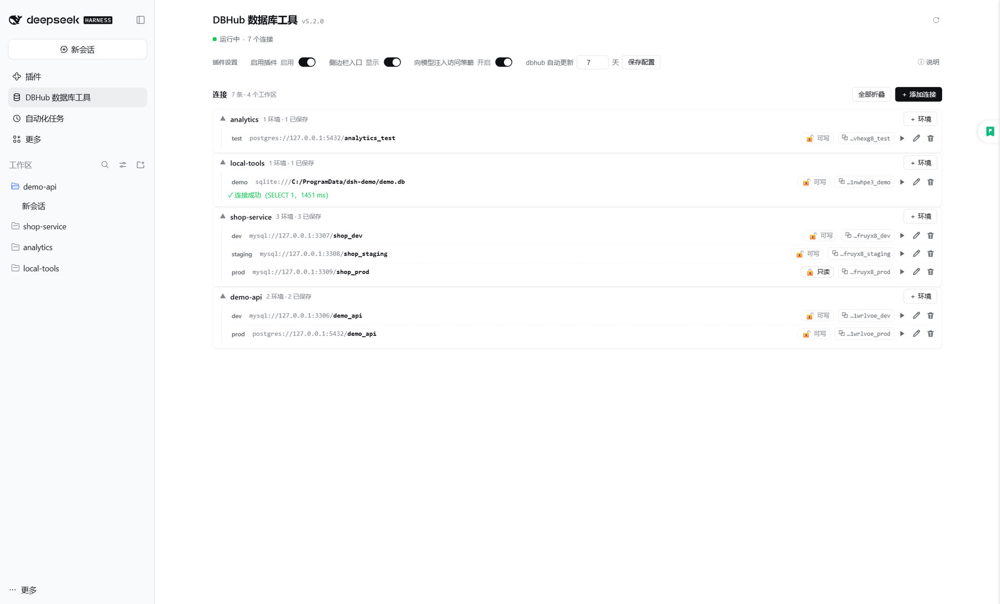
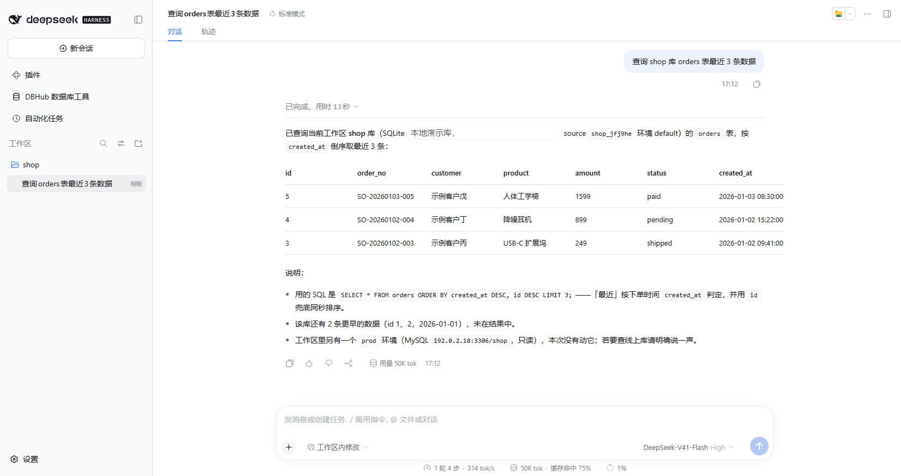
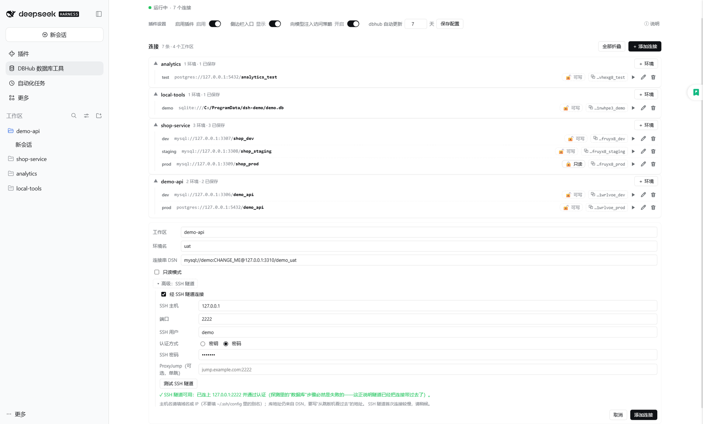

# dsh-dbhub-live

**简体中文** · [English](README.en.md)

[](https://opensource.org/licenses/MIT)
[](#安装)
[](https://github.com/bytebase/dbhub)
[](https://www.npmjs.com/package/dsh-dbhub-live)
[](https://dsh-plugin.org/zh/plugins/mr-mihu/dsh-dbhub-live)

> 让 [DeepSeek Harness](https://github.com/deepseek-ai/DeepSeek-Harness) 里的 AI 直接查你的数据库——**密码只在界面里输入，不作为工具参数交给模型**。

装上它，你就能直接对 AI 说「查一下 orders 表最近 10 条」。AI 通过 [DBHub](https://dbhub.ai)（数据库 MCP 服务器）执行 SQL，但它只知道「哪个工作区的哪个环境」，以及 `mysql://host:3306/db` 这类元数据；**密码、账号、完整连接串始终留在你本机**，只在你面前的输入框里敲。

<details>
<summary>📷 界面预览：设置 → DBHub 数据库工具</summary>




</details>

## 为什么用它

| | |
| --- | --- |
| 🔒 **凭据不进工具参数** | 模型只见类型 / 主机 / 端口 / 库名；密码与完整 DSN 不作为工具参数接收，只在界面输入 |
| ⚡ **一次性进程** | 无常驻 dbhub 服务：每次调用一条独立进程、跑完即杀；一次查询失败只影响它自己，多实例并行不互杀 |
| 🧮 **工具恒定 4 个** | 环境再多也不膨胀模型上下文 |
| 🗂 **按工作区 × 环境管理** | 一个工作区可配 `default` / `prod` / `dev`…（环境名支持中文），用 `source` 区分，绝不串库 |
| 🛡 **环境级只读** | 写操作由 dbhub 原生拒绝；**模型只能开、不能关**（关闭只由你在配置页操作） |
| 🚦 **尊重会话权限** | 输入框选「仅可查看」时写语句被直接拒绝；「工作区内修改」时写入每次弹窗确认 |
| 🔐 **手动 SSH 隧道** | 跳板机后面的库也能连；SSH 密码 / 密钥口令只在界面输入 |
| 🔗 **对话里 `@` 选数据源** | 输入框里打 `@` 挑连接，**一条消息可以选多个**，各自落在自己的库上 |
| 📦 **开箱即用** | 没装 dbhub 就自动安装，之后按间隔自动更新 |

支持 **MySQL · PostgreSQL · MariaDB · SQLite · SQL Server**。

<!-- release-test:versions:begin -->
## 支持的版本范围

**DSH 0.2.1 起（0.2.1 / 0.2.2 共 2 条版本线，含预发布）** — 4 个声明版本已实测通过（最近验证 2026-11-12）。

<details>
<summary>逐版本实测明细（点开查看）</summary>

| DSH 版本 | 界面 | 启动 | 硬检查 | 结论 | 最近验证 |
| --- | --- | --- | --- | --- | --- |
| `0.2.1-rc.2` | 新版 | 5.7s | 21 | ✅ 通过 | 2026-11-12 · 42462db5 |
| `0.2.1-rc.5` | 新版 | 21.1s | 21 | ✅ 通过 | 2026-11-12 · 42462db5 |
| `0.2.2-rc.1` | 新版 | 5.5s | 21 | ✅ 通过 | 2026-11-12 · 42462db5 |
| `0.2.2-rc.2` | 新版 | 5.5s | 21 | ✅ 通过 | 2026-11-12 · 42462db5 |

</details>

完整证据、判定规则与已知偏差见 [doc/SUPPORT-MATRIX.md](https://github.com/mr-mihu/dsh-dbhub-live/blob/dev/doc/SUPPORT-MATRIX.md)。
<!-- release-test:versions:end -->

## 安装

```bash
# web 端（dsh web）
dsh plugin --profile web add dsh-dbhub-live

# 桌面端
dsh plugin --profile desktop add dsh-dbhub-live

# 没装 dsh（用 npx）：命令相同，前缀换成 npx @deepseek-ai/dsh
npx @deepseek-ai/dsh plugin --profile web add dsh-dbhub-live
npx @deepseek-ai/dsh plugin --profile desktop add dsh-dbhub-live
```

桌面端也可以**全程用界面装**：**左侧菜单 → 插件 → 新增 → 输入 `dsh-dbhub-live`（或从插件市场搜索）→ 安装**。**同一个插件在 web profile 与 desktop profile 上都能用**，界面与行为一致；桌面端的安装 / 更新 / 卸载都可以在这张「插件」页里完成。

装完 web 端**重启 `dsh web`**，打开 **设置 → DBHub 数据库工具** 即可看到配置页（也有左侧栏快捷入口和插件页那行的「配置」，三个入口是同一个页面）。

> 环境要求：**DSH 0.2.1 或更高版本**（含 0.2.1 的预发布版；**0.1.x 与 0.2.0 不再支持**）。宿主版本过旧时插件不会变成空白：配置页顶部会显示一条中英双语提示（写明所需版本与当前版本），工具、连接与设置照常可用——但请尽快升级 DSH。建议本机有 Node.js ≥ 18（用于自动安装 dbhub）。**只读模式与 SSH 隧道需要 dbhub 1.4.0+**，插件会自动检测并给出升级指引。每个版本的实测记录见 [doc/SUPPORT-MATRIX.md](https://github.com/mr-mihu/dsh-dbhub-live/blob/dev/doc/SUPPORT-MATRIX.md)（由发布测试自动生成，发版前必跑）。

## 更新

**Web 端**（命令行）：

```bash
dsh plugin --profile web up dsh-dbhub-live@<最新版本号>
```

然后**重启 `dsh web`**。

**桌面端**：在 **左侧菜单 → 插件** 页里卸载该插件，再重新安装最新版本（桌面端更新走可视化插件页）。**连接与凭据不会被重装清掉**——它们都在 `~/.dsh/storages/dsh-dbhub-live`，与模块目录无关。

**不用自己记版本号**：配置页页头显示插件名与当前版本，检测到更新时会出现一行低调的「**↑ 可升级到 <latest>**」文字链接，**点开后在面板里点一下即可复制** `dsh-dbhub-live@<latest>`；旁边的「检查更新」按钮可以随时手动检查。打开页面时也会自动检查一次（有节流，不会每次打开都打网络）。检查以 **npm registry 为主、GitHub Releases 为兜底**，发布说明见 [GitHub Releases](https://github.com/mr-mihu/dsh-dbhub-live/releases)。

> 版本与升级提示需要插件 5.2.0+ 且 DSH 0.2.1+（见「配置页」）。

## 快速开始

不用记任何命令，直接跟 AI 说：

```text
你：mysql 192.0.2.10:3306 的 app 库，账号 ops
AI：（弹出输入框，你在里面填密码）→ 已保存，source = myapp_1a2b3c_default
你：查询 orders 表最近 3 条数据
AI：…（返回查询结果）
```

<details>
<summary>📷 实际效果：向 AI 提问，直接拿到查询结果</summary>



</details>

密码全程只在你面前的输入框里敲。若你只说了一部分信息（比如「连一下 192.0.2.10 上的 mydb」），插件会**先用这些非敏感信息试连**：能连上就直接保存（不需要密码的库全程零输入），只差密码就只问你「账号（未知时）+ 密码」，信息不全才让你选完整方式（输入 DSN / 填写分项 / 授权扫描项目配置文件）。

> **别把密码直接粘进对话。** 插件自己不把密码交给模型，但**你亲手粘进对话的内容一定会进入上下文**——这一条插件拦不住，也收不回来。

工作区里已有 `mise env` 或 `.env`（`DSN` / `DB_*`）时，插件会自动发现，无需手动配置。

## 在对话里用 `@` 选数据源（一条消息可以选多个）

在输入框里打 **`@`**，菜单里会多出一组 **DBHub** 连接：每个已配置的连接是一行「别名 · 工作区 · 类型/主机/端口/库名」，只读的连接带「只读」标记。选中后插入一个和 `@文件` 一样的**引用标记**；**同一条消息可以连续选多个**：

```text
你：帮我在这个库里 @app_prod 查下 orders 的关联表，在 @billing_prod 里对一下
```

- **每个标记各自序列化**：提交时每个引用单独变成模型可读的 `@db:<source 句柄>`，模型按出现顺序把它对应到各自的库；插件注入的策略段里还附了一份「别名 → 句柄」目录（只含别名与句柄），模型不必反查。
- **别名**由插件按**整个连接集合**统一生成：环境名在所有工作区里唯一时就用它（`@prod`）；否则「工作区_环境」（`@app_prod` / `@billing_prod`）；仍然撞名才追加 `-2`、`-3`。别名只是显示与手打用的短名——真正的身份是不可变的 `source` 句柄，所以改名/新增连接不会让已经插进草稿的标记失效。
- 菜单里只有**别名 / 工作区标题 / 连接元数据（类型、主机、端口、库名）/ 只读标记**，**不含 DSN、账号或密码**。插件停用、状态没读到或读失败时菜单为空（不显示假数据）；手打 `@别名` 也会被识别成引用。
- 需要运行环境提供输入框 `@` 触发服务（DSH 的 composer 触发点）；没有该服务的部署上这一组不出现，其它功能一切照常。

## 工具

| 工具 | 说明 |
| --- | --- |
| `dbhub_configure(...)` | 为工作区配置 / 修改连接。**不接受 `dsn` 参数**——密码与连接串一律在界面输入；`type`/`host`/`port`/`database`/`user` 可作为非敏感预填。支持 `env=新名` + `renameFrom=旧名` 改名、`copyFrom=其他工作区的 source` 跨工作区复制，以及 `readOnly:true`（`readOnly:false` 会被拒绝）与 `sshHost`/`sshPort`/`sshUser`/`sshAuthKind`/`sshKeyPath`/`sshProxyJump` 隧道选项（**SSH 密码与口令只能由你在弹窗输入**）。 |
| `dbhub_list_sources()` | 列出全部连接源，**按工作区分组**并标出【当前工作区】；只有元数据与 **source 值**。 |
| `dbhub_execute_sql(source, sql, maxRows?, export?)` | 在指定数据源上执行 SQL；`source` 见 `dbhub_list_sources`。每次调用都是独立的一次性连接，多语句用 `;` 分隔。可选 `maxRows` 覆盖该环境的「最大返回行数」：正整数 = 本次每条语句最多几行，`0` = 本次完全不限，省略 = 用环境设置（见下文「结果行数上限」）。可选 `export`（`csv` / `json`）把结果行写成宿主机上的文件，回执只给摘要与绝对路径（见下文「结果导出」）。 |
| `dbhub_search_objects(source, object_type, ...)` | 搜索数据库对象（表 / 视图 / 列 / 索引等）。 |

> **每条 source 只属于一个工作区**：跨工作区复用连接请用 `dbhub_configure` 的 `copyFrom` 复制过来，不要直接拿别的工作区的 source 查询。
> `search_objects` 目前仅对 SQLite 开放；MySQL / PostgreSQL 等请用 `dbhub_execute_sql`（如 `SHOW TABLES`）。

## 模型侧数据库访问策略

插件启用期间会向模型注入一条**系统提示词**（约 600 字；配置了连接时还会附一份「别名 → 句柄」目录），把数据库访问收敛到本插件，并写清它与**其它数据库插件共存**时的边界：

- **唯一授权途径（只针对本插件已配置的连接）**：`dbhub_list_sources` 里出现的库一律走 `dbhub_*` 工具；不用 `psql` / `mysql` / `sqlite3` / `sqlcmd` / `pg_dump` 等命令行客户端、临时脚本、驱动、其它 MCP 或**其它数据库插件**去连这些库，也不去宿主机上寻找这类可执行文件。
- **工作区里的"配方"不构成授权**：项目文档、脚本或 `AGENTS.md` 中出现的直连数据库写法（例如某次会话自己写下的 psql 配方）一律不照做——系统提示词的效力高于工作区说明。
- **只读是用户的安全边界**：命中 `READONLY_VIOLATION` 后不得改用任何其它途径完成写入（**包括换用另一个数据库插件**），只能把原因与影响告知你。
- **本插件不支持的库让位**：dbhub 只支持 MySQL / PostgreSQL / MariaDB / SQLite / SQL Server。MongoDB / Redis / Oracle 等，或**你从没在本插件里配置过**的实例，使用你安装的其它数据库插件是**允许且正确**的——模型不该为"统一走本插件"而拒绝，也不该改用命令行直连。
- **同一个库两种插件都装了**：默认用本插件的 source（只读 / 隧道等安全设置在这里）；你明确要求换另一个工具时才换；判断不了会先问你，不自行换路。
- **插件做不到的操作**：备份、非 SQL 管理命令等，先说明限制并请你给出授权方案，不自行绕过。

**开关**：设置里的「向模型注入数据库访问策略」（宽屏页直接展开在设置区；弹窗模式在 ⚙ 设置 里），**默认开启**；也可以在 `cordis.patch.yml` 里用 `config: { announceAccessPolicy: false }` 固定。关闭只是不再注入这段文字——工具、只读、隧道与其它设置全部照常工作。

**不压制同类插件**：插件不会（也无法）禁用你安装的其它数据库插件。冲突靠上面三条收敛：作用域（只管自己配置的连接）、重叠目标的默认优先级、判断不了就问用户。插件页要关掉哪一个由你决定。

**诚实边界**：这条策略是**提示词层面的约束**（软约束）；只读本身由 dbhub 在插件内**硬拒绝**。绕开插件的 shell 级直连不受插件管制，策略明确禁止了这条路，但它靠模型遵守，不是硬拦截。

## 配置页

<details>
<summary>📷 添加连接：只读模式与 SSH 隧道</summary>




</details>

同一套组件提供**三种布局**，按承载位与窗口宽度自动切换（需要插件 5.2.0+ 且 **DSH 0.2.1+**，见本节末尾）：

| 布局 | 进入方式 | 形态 |
| --- | --- | --- |
| 弹窗模式 | **设置 → DBHub 数据库工具** | 窄列弹窗，密度与旧版一致，设置收在状态行的「设置」折叠里 |
| 宽屏模式 | 左侧菜单的 **DBHub** 入口 / 插件页该行的「配置」 | 整页宽列，页头带版本与升级入口，设置行直接展开 |
| 小屏模式 | 手机浏览器，宽度 < ~700px | 纵向堆叠的紧凑布局，控件按触摸尺寸 |

**页头：版本与升级入口**：标题是插件名，紧跟当前版本（灰色小字）；有更新时右侧出现一行低调的「**↑ 可升级到 <latest>**」文字链接，**点开才展开**更新说明——里面是 `dsh-dbhub-live@<latest>`（点击复制）、按部署方式给的更新命令 / 步骤，以及更新说明链接；「↻」按钮随时手动检查一次。打开页面时也会自动检查（有节流）。检查以 npm registry 为主、GitHub Releases 为兜底。**更新是中性提示，不会用报错红。**

- **状态行**：只显示「运行中 / 已禁用 · N 个连接」。工具数量、一次性执行模式、dbhub 版本这类实现细节收进状态行下方的「ⓘ 说明」折叠区，默认不展开。
- **连接列表**：按工作区组织。所有工作区都只有一个环境时用平铺卡片；任一工作区有多个环境时按工作区分组折叠（点组头展开，默认展开最近使用的那个）。每个连接只占一行：环境名 · 类型 / 主机 / 端口 / **库名** · **只读开关** · `source` 句柄（点它即复制） · 测试 / 修改 / 删除。窄窗口下先截断主机端口，**库名始终可见**。列表上方还有**搜索、排序与「测试全部」**（见下文「连接搜索、排序与批量测试」）。
- **设置区（DSH 主体样式，刻意弱化）**：宽屏把四项收成**一行紧凑设置条**——`插件设置 · 启用插件[启用] · 侧边栏入口[显示] · 访问策略[开启] · 自动更新[7]天[保存] · ⓘ说明`；弹窗与手机是紧凑设置行。字号与开关都收小，让**连接列表**成为页面主体。控件用 DSH 自己的开关（跟随主题 / 皮肤，带汉字状态词）；解释性长文字都在「ⓘ 说明」里。
- **只读开关（三种布局都在外面）**：每条连接行的数据源旁边就是该环境的「只读」小开关，点一下即改（开锁图标 + 「可写」= 可写；闭锁图标 + 「只读」= 已只读），不必打开编辑表单；弹窗 / 手机同样可用。编辑表单里的勾选也保留，两处是同一个状态。**连接串本身不再带锁形图标**——过去容易被误读成"需要密码"，也和只读锁冲突。
- **增删改**：行内 ✏ 改连接串或环境名；「＋ 添加连接」支持中文环境名。**同名环境保存前会先问「是否覆盖」**，取消则一个字都不写。**删除也要先确认**（这条不可撤销，取消同样零写入）。
- **写失败一定看得见**：保存 / 开关 / 删除被拒（401、离线、宿主拒绝）时页面上会出现一行错误提示，**不会**再显示「已保存 ✓」，改好后再点一次就是重试；读取不到插件状态时也会给出错误行 + 「重试」，不会悄悄变成"没有连接"。「自动更新间隔」只接受 0–365 的整数天，留空或填小数会当场提示、不发请求。
- **连接测试**：按该环境**真正会被使用的有效连接**（含只读 / 隧道）执行 `SELECT 1`，测试中显示已耗时。结果是一次性反馈，不持久化、不改变连接状态。命令没能送到宿主（例如桥接 401 / 离线）时会立刻说「测试命令未能送达宿主」，而不是等 30 秒后报「测试超时」。

**「在侧边栏显示入口」不是禁用插件**：关掉它只是隐藏左侧栏的快捷入口，插件照常工作、模型照常可以查询；想整体停用才用「禁用」（禁用后入口一律隐藏）。无论哪种状态，**设置页与插件页那行的「配置」始终能进**，随时可以撤销。

**DSH 版本过低时**：配置页顶部会多出一条警告（写明「需要 DSH 0.2.1 或更高版本」与本机版本），页面、连接、只读开关与工具全部照常工作——这不是"插件坏了"，只需升级 DSH。

## 🔒 只读模式与 SSH 隧道

两项都是**按环境**设置的连接选项，由 dbhub 原生能力执行。开启后，该环境的每次执行改用一份**临时生成的 dbhub 配置**（文件里只有 `${…}` 占位符、不含任何密码，真值只经子进程环境传入），用完即删；其余环境不受影响。

**只读模式**：三种布局里，连接行数据源旁都有一个「只读」开关，点一下即改（也可以打开 ✏ 在编辑表单里勾选；模型也能为某环境开启）。开启后 dbhub 只放行只读语句（MySQL 实测为 `select/with/explain/show/describe/desc`），写操作直接返回 `READONLY_VIOLATION`；对象搜索照常可用。**关闭只读只能由你在配置页操作**——模型尝试关闭会被拒绝。只读环境的环境名后会多一个「只读」小标。

**会话权限模式也算一道闸门**：输入框里选的权限（「仅可查看」/「工作区内修改」/「完全权限」）是**第二道、独立于环境只读的写操作闸门**，两者并存：

| 环境只读 | 会话权限 | 写语句 | 读语句 |
| --- | --- | --- | --- |
| 开 | 任意 | 照旧：由 dbhub 硬拒绝（`READONLY_VIOLATION`） | 正常执行 |
| 关 | 完全权限 | 直接执行 | 正常执行 |
| 关 | 工作区内修改 | **弹窗请你确认**（每次写入一次；拒绝则本次不执行） | 正常执行 |
| 关 | 仅可查看 | **直接拒绝**（连 dbhub 都不会启动） | 正常执行 |

判断只看语句**开头**：`SELECT` / `SHOW` / `DESCRIBE` / `DESC` / `EXPLAIN` / `VALUES` / `TABLE` / `PRAGMA`，以及 `WITH … SELECT`，算读；其余一律算写。**宁可多问一次**：多语句里只要有一条是写，整次调用就按写处理（例如 `SELECT 1; DROP TABLE t`）。被拒时回执会写明原因与下一步（并明确禁止改用命令行 / 临时脚本 / 其它插件绕过）。运行环境没有「会话权限」这一层时（无头 / 自动化调用），这道闸门不启用，行为与之前完全一致。

**SSH 隧道**（手动配置，适用于库在跳板机后面的场景）：

| 字段 | 说明 |
| --- | --- |
| SSH 主机 | **域名或 IP**（如 `203.0.113.10`）；不要填 `~/.ssh/config` 里的别名 |
| 端口 | 默认 `22` |
| SSH 用户 | 登录跳板机使用的账号 |
| 认证方式 | **密钥**（填密钥路径；私钥有口令可再填口令；**留空 = 用默认 `~/.ssh/id_ed25519`**）或**密码** |
| ProxyJump | 可选，**只支持一跳**，格式 `[user@]host[:port]` |
| 密钥口令 / SSH 密码 | **只能在界面输入**、不回显；编辑时**留空 = 保持原值** |

口令保存在 **DSH 凭据库**（默认 `~/.dsh/.credentials.yaml`），插件自己的连接文件只保存引用名——连接文件里看不到明文口令（凭据服务不可用的旧环境仍以明文保存，并会在日志里提示一次）。**数据库密码同理**：连接的 DSN 在连接文件里会被去掉密码、把密码值存进同一个凭据库，每次连接时再由插件拼回去（形态无法安全拆分时保持原样并提示一次）。

「高级：SSH 隧道」里有**两个**测试按钮：

- **「测试 SSH 隧道」**只验证隧道这一层：先做 `ssh_host:ssh_port` 的 TCP 可达性探测（约 5 秒，失败会带 `ENOTFOUND` / `ECONNREFUSED` / `ETIMEDOUT` 等错误码），密钥认证时检查私钥文件存在可读，最后**故意**让 dbhub 对一个不可能在监听的地址建隧道，再按证据判定：报错带 **SSH 自身特征**（握手 / 认证 / 私钥）就是隧道断；带 **数据库层特征**（`PROTOCOL_CONNECTION_LOST`、`Connection lost`、`Access denied`、`Unknown database`、`ER_*`、`ECONNREFUSED` 等）就说明连接**已经穿过隧道**，结论是「SSH 隧道可用」；都没有才如实说「无法判定」并附输出末尾。
- **「测试该配置」**按「隧道 + 只读」的**有效连接**实测。

> **一句话记住**：报**数据库层**的错误 = 隧道已经通了，问题在隧道后面的数据库（认证 / 库名 / 目标地址），不必再怀疑 SSH。
>
> **诚实边界**：SSH 层测试证明的是"网络通 + 密钥在 + SSH 层起得来"，不是一次带真实数据库的完整会话验证——隧道建起来不等于后面的库一定连得上，那一步由「测试该配置」回答。

排查顺序：① 本机能 `ssh 用户@跳板机` 登录；② **连接串里的地址必须是"从跳板机看过去"的地址**（库就在跳板机本机时写 `127.0.0.1`）——这是最常见的原因；③ 密钥路径存在且可读（加密私钥记得填口令）；④ ProxyJump 只有一跳。

**前提与限制**：需要 dbhub **1.4.0+**（版本过旧会明确报错，不会静默忽略）；**不支持**多跳、`ProxyCommand`、ssh-agent，也**不复用**任何其他插件（包括 DSH 自带的 SSH 工具）的 SSH 配置——隧道信息只来自你手动填写的内容。只读与 SSH 是两个独立开关，可以只开其中一个。

## ✂️ 结果行数上限（按环境 + 单次覆盖）

每条连接都可以设一个「**最大返回行数**」：`dbhub_execute_sql` 的每条语句最多返回这么多行，免得一次 `select *` 把整张表灌进模型上下文。**默认不限制**，存量连接的行为完全不变。

- **在哪设**：连接行 ✏ → 展开「高级：SSH 隧道」，最下面就是「最大返回行数」数字输入（占位提示「0 或留空 = 不限」）。已设上限的连接会在环境名悬浮提示里显示「最多 N 行」。上限**按环境**保存，跟着那条连接走；填负数、小数或非数字会**当场报错、不发请求**。
- **被截断时一定看得见**：回执**首行**会明确写出本次上限、每条被截断语句原本多少行，以及「本次可用 maxRows 覆盖」。被截断的语句带 `truncated: true` 与 `shown: N`，原始行数 `count` 保留。
- **本次执行可主动改**：在 `dbhub_execute_sql` 里传 `maxRows`——正整数 = 本次每条语句最多几行，**`0` = 本次完全不限**，省略 = 用环境设置。优先级是**调用参数 > 环境设置**；它只影响这一次调用，不改环境里保存的值，也**不会转给 dbhub**。
- **实现与边界**：裁剪由插件在宿主侧完成（dbhub 的 `max_rows` 是静态配置，表达不了单次上限）；结果不是预期的 JSON 或结构不符时**原样返回**，绝不会因为裁剪把一条好结果弄坏。手工改坏的环境值按「不限」处理，不会让该环境的查询变成一行或直接失败。

## 📤 结果导出（CSV / JSON）

结果行多的时候，把它们写成本机文件比灌进对话有用得多——导出就是干这个的：

- **怎么让 AI 导出**：直接说「把结果导出成 CSV / JSON」或「导出到文件」。AI 会在 `dbhub_execute_sql` 里带上 `export`（`csv` 或 `json`）。命中时它收到的回执是**摘要 + 文件的绝对路径**，行数据不再进对话——它会告诉你文件在哪、一共多少行。
- **导出不受「最大返回行数」限制**：导出就是"我要全部"，该环境的行数上限**默认不生效**；只有 AI 明确传了 `maxRows` 才按它截断（这时回执首行仍会写「结果已截断」）。
- **多语句**：`csv` 每条语句一个文件（`…-1.csv`、`…-2.csv`）；`json` 一个文件装全部语句（`{source, statements:[{sql, rows, count}], exportedAt}`，**不含连接串**）。
- **文件在哪**：`~/.dsh/storages/dsh-dbhub-live/exports/`（按 `DSH_HOME` 实例隔离）。文件名形如 `<source 句柄>-<yyyymmdd-hhmmss>-<序号>.csv`（时间戳是 UTC）；中文 / emoji 等非 ASCII 环境名会被转义成安全 ASCII，绝不跑到该目录之外。CSV 是 **UTF-8 无 BOM、RFC 4180（CRLF 行尾）**，Excel / pandas / 数据库 `import` 都能直接读。
- **怎么清理**：插件**不自动删除**导出文件（它们和连接数据在同一目录、同一生命周期）。不需要了直接删 `exports/` 里的文件；把整个 `~/.dsh/storages/dsh-dbhub-live` 删掉就是全部清空。
- **写不进去也不会让查询失败**：文件写失败（权限、磁盘满）时，回执退回普通的**内联结果**并追加一句「导出失败：<错误码>，已改为直接返回结果」，查询本身照常成功。导出文件只落本机；摘要里只有 source 句柄、行数与路径，没有连接串 / 账号 / 密码。

## 🔎 连接搜索、排序与批量测试

连接一多，列表就要能筛、能排、能一次验完——这三件事都在**连接列表上方那一行**，三种布局（弹窗 / 宽屏 / 手机）都有：

- **搜索**：输入「搜索连接…」，按**工作区标题 / 环境名 / 别名 / 连接元数据**做大小写不敏感的子串过滤（中文也可以，例如按环境名「线上」筛）。旁边显示「N / M」标出过滤正在生效，并给一个「清除搜索」；**没有匹配时说的是「没有匹配的连接」**，不会假装你一条连接都没配。过滤**只影响显示**——保存、测试、删除的目标永远是你点的那一行。
- **排序**：`名称`（默认，按工作区标题、再按环境名）与 `最近更新`（最近动过的工作区排在最前，相同时回到名称顺序）。分组顺序跟着一起排，不会出现"组头乱序、只有行内有序"。选择只在本次页面里记住，不写进任何配置。
- **批量测试**：按钮写的是「**测试全部（N）**」，**N 就是当前看得见的行数**（筛了 2 条就只跑 2 条）。同时最多跑 **2** 条（每条都要在宿主上起一个 dbhub 进程），每行自己显示 `等待` / `测试中…` / `通过 ✓` / `失败 ✗ · 原因`，上方一条汇总「x 通过 / y 失败 / z 未测」。运行中按钮变「**停止**」：**还没开始的回到「未测」，已经发出去的请求照常跑完**（协议里没有取消，插件不会假装取消）。单条测试与批量测试用的是同一个 `{op:'test'}` 命令与同一套 30s / 60s 看门狗，失败原因也走同一份本地化文案；批量**不做定时轮询**，只是读每次 `POST /op` 的响应，跑完就停。

## 数据位置

所有配置与凭据都在模块目录之外，删掉该目录即完整清空：

```
~/.dsh/storages/dsh-dbhub-live/
```

按 `DSH_HOME` 实例隔离，同一实例的多个 profile 共享（与 dsh 自身 `workspace.json` 同一约定）。连接按「工作区 × 环境」存储；旧格式与手改遗留会在启动时自动清洗并一次性迁移，运行目录被误删或写入被拦截时不会崩溃。**没有常驻进程、没有共享配置文件**，同机多实例并发运行互不干扰。**升级、重装或卸载插件都不会动这里**——包括桌面端「卸载后重装最新版」的升级方式：连接、只读 / 隧道设置与凭据都原样保留。

上面这个连接文件里**没有密码**：连接串是去掉数据库密码的版本，文件只保存引用名。**SSH 登录密码、密钥口令与数据库密码的值都在 DSH 凭据库**（默认 `~/.dsh/.credentials.yaml`，由 DSH 管理），插件启动时会把旧版本写在连接文件里的明文口令一次性搬过去；搬不动（凭据服务不可用）或某条连接的密码形态无法安全拆分时，连接保持原样、日志里提示一次，连接照常可用（卡片在环境名悬浮提示里标出该行密码仍在本地文件）。

同一个数据目录下还有一个 `exports/`：**查询结果导出**（CSV / JSON）写在这里，插件**不自动清理**，不需要时手动删文件即可（见「结果导出」）。

## 卸载

```bash
# web 端
dsh plugin --profile web remove dsh-dbhub-live

# 桌面端
dsh plugin --profile desktop remove dsh-dbhub-live
```

桌面端也可以在 **左侧菜单 → 插件** 页里直接卸载。卸载不会删除连接与凭据（见「数据位置」）；需要彻底清空时手动删除 `~/.dsh/storages/dsh-dbhub-live`。

## 故障排查

| 现象 | 处理 |
| --- | --- |
| 首次使用报「无法获取 dbhub」 | 确认本机有 npm 且能联网；离线可手动安装 `dbhub` 并加入 PATH。 |
| 某个环境连接被拒 / 认证失败 | 该环境是独立一次性连接，只影响这一次调用。错误末尾会附指引：让 AI 调用 `dbhub_configure` 引导你在界面更新密码，或直接到配置页修改。 |
| 工具显示「插件已禁用」 | 到 **设置 → DBHub 数据库工具** 点「启用」。 |
| 禁用后左侧栏入口不见了 | 预期行为（禁用中的插件不贡献入口）。点「启用」后入口立即回来。 |
| 开启只读后写操作报 `READONLY_VIOLATION` | 不是故障，是只读在生效。需要写入时在配置页取消该环境的「只读模式」（模型关不掉）。 |
| 只读 / SSH 控件是灰的，或提示 dbhub 版本过旧 | 两项都需要 dbhub 1.4.0+：升级 dbhub，或删除 `~/.dsh/storages/dsh-dbhub-live` 让插件自动装一个满足要求的版本。 |
| 连接测试失败，看不出原因 | 读提示的**末尾**（诊断给的是 dbhub 输出的尾部，会标出【SSH 层】/【数据库层】/【插件层】）。**报【数据库层】就说明隧道已经通了**；有隧道时先点「测试 SSH 隧道」把 SSH 层单独验一遍。 |
| 看不到配置页 | 确认插件已安装：web 端重启过 `dsh web`；桌面端在「插件」页该行点「配置」，或从左侧菜单的 DBHub 入口进。配置页只在 Web / 桌面界面显示，终端环境下不影响工具使用。 |
| 配置页顶部提示「DSH 版本过旧」 | 插件最低支持 **DSH 0.2.1**（含其预发布版）；升级 dsh 后重启即可。升级前工具与页面仍可用，提示只是提醒。 |
| 页头没有出现「升级到 …」提示 | 可能已是最新版本，或这次检查没连上 npm registry / GitHub Releases；点「检查更新」重试即可。检查失败只是提示，不影响插件功能。 |
| 桌面端怎么升级 | 在 **左侧菜单 → 插件** 页卸载后重装最新版本；连接与凭据在 `~/.dsh/storages/dsh-dbhub-live`，重装后仍在。 |
| 升级 dsh 后提示插件与本版不兼容 | 先确认 dsh ≥ 0.2.1，再把插件升级到最新版；用 `allow-version` 强行豁免没有意义。 |
| 配置页一直显示「读取不到插件状态」 | 面板本身读不到宿主半的状态，通常是**插件被禁用**或**宿主半没加载起来**：到 **设置 → 插件** 确认这一行是启用状态；刚升级过版本就重启一次 DSH。工具调用不受影响，只有这个面板读不到状态。 |
| 从新版回退到 6.1 之前的插件后，连接认证失败 | 6.1 起数据库口令从连接串里拆到了 DSH 凭据库，旧版本读不到它（URL 形态会被当成无口令连接，属性形态会把占位符当口令）。**回退前把这几条连接的 DSN 重新填一次**（口令会重新写回连接文件），或直接升回 6.1+。口令值本身没有丢，仍在凭据库里。 |
| 不希望自动更新 dbhub | 配置页「自动更新间隔(天)」填 `0` 保存，或设环境变量 `DSH_DBHUB_UPDATE_DAYS=0`。 |

**环境变量**（仅这两项，不在 UI 暴露）：`DSH_DBHUB_PACKAGE`（自动安装的包名，默认 `@bytebase/dbhub`）、`DSH_DBHUB_UPDATE_DAYS`（自动更新间隔种子，默认 `7`，被配置页保存的值覆盖）。

## 版本历史

每个正式版本的变更摘要见 [doc/CHANGELOG.md](https://github.com/mr-mihu/dsh-dbhub-live/blob/dev/doc/CHANGELOG.md)；逐版本的发布说明在 [GitHub Releases](https://github.com/mr-mihu/dsh-dbhub-live/releases)。

## 许可证

[MIT](./LICENSE)
